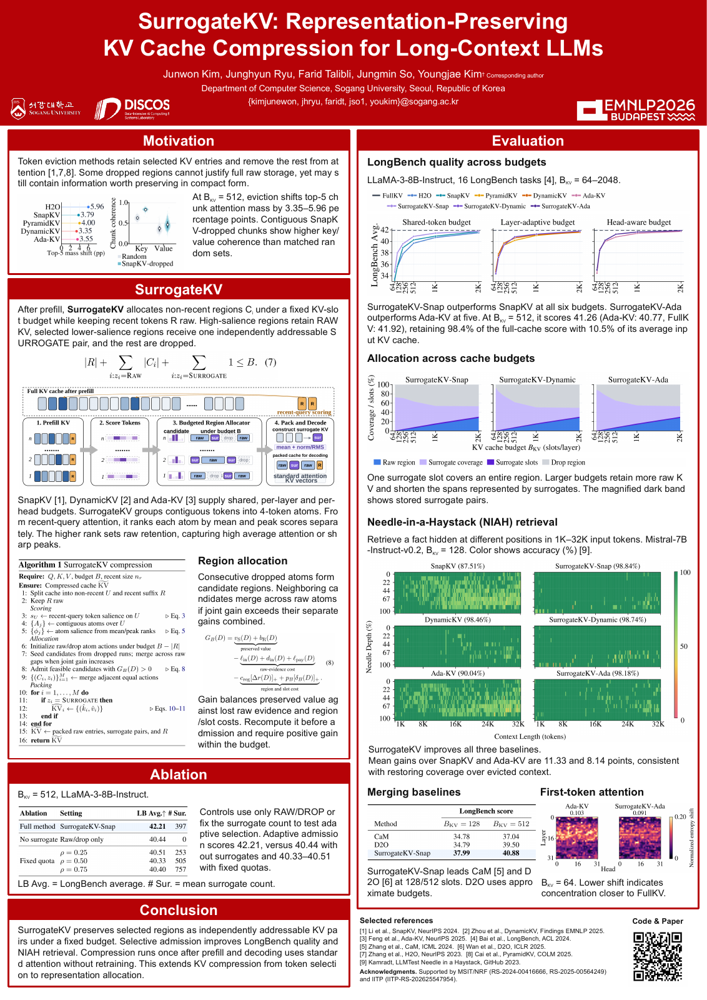

  <a href="https://www.sogang.ac.kr/"><picture><source media="(prefers-color-scheme: dark)" srcset="docs/sogang-logo-dark.svg"></picture></a>
  &nbsp;
  <a href="https://discos.sogang.ac.kr/"><picture><source media="(prefers-color-scheme: dark)" srcset="https://github.com/kimjunewon/SurrogateKV/blob/ca94f111c89df166c3421e824e22ff594281ce76/docs/discos-logo-dark.png?raw=true"></picture></a>

<h1 align="center">SurrogateKV</h1>

  <strong>Representation-Preserving KV Cache Compression for Long-Context LLMs</strong> 
  Findings of EMNLP 2026

  
  
  
  

  <strong>Junwon Kim</strong> &middot; DISCOS Lab, Sogang University 
  <a href="mailto:kimjunewon@sogang.ac.kr">kimjunewon@sogang.ac.kr</a>

   
  <a href="docs/EMNLP2026_Find-6068.pdf"><strong>View the EMNLP 2026 poster (PDF)</strong></a>

SurrogateKV adds a third representation under the same cache-slot budget:
a contiguous historical region can be replaced by one independently addressable
surrogate KV pair. The packed cache uses standard attention during decoding.

## Documentation

- [Method overview](docs/METHOD.md)
- [Installation, runtime API and evaluation](docs/USAGE.md)
- [Results and released data](docs/RESULTS.md)
- [Citation and notices](docs/CITATION.md)

Copyright (c) 2026 Junwon Kim. All rights reserved. See [copyright and third-party notices](docs/CITATION.md#copyright-and-third-party-notices).
