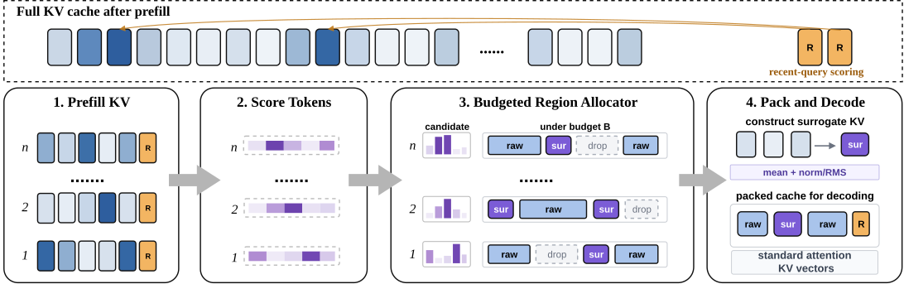

# Method overview

[Back to SurrogateKV](../README.md)

Official implementation and result release for **SurrogateKV:
Representation-Preserving KV Cache Compression for Long-Context LLMs**
(Findings of EMNLP 2026).

Token-level KV compressors ordinarily retain selected entries and discard the
rest. SurrogateKV adds a third representation under the same cache-slot
budget: a contiguous historical region can be replaced by one independently
addressable surrogate KV pair. Salient entries remain exact, admitted regions
become surrogates, and the remaining regions are dropped. The packed cache
contains ordinary KV pairs and uses standard attention during decoding.

SurrogateKV is evaluated on three base compressors. The resulting variants are
SurrogateKV-Snap, SurrogateKV-Dynamic, and SurrogateKV-Ada.

  <a href="../data/images/surrogatekv_overview.pdf">
    <picture>
      <source media="(prefers-color-scheme: dark)" srcset="../data/images/surrogatekv_overview-dark.svg">
      <source media="(prefers-color-scheme: light)" srcset="../data/images/surrogatekv_overview.svg">
      
    </picture>
  </a>

The editable source for the overview is available as a
[draw.io file](../data/images/source/surrogatekv_overview.drawio). The diagram
shows the mean-plus-norm constructor used by all three variants.

## Variants

| Variant | Runtime mode | Base allocation |
| --- | --- | --- |
| `SurrogateKV-Snap` | `surrogate_kv` | SnapKV shared-token selection |
| `SurrogateKV-Dynamic` | `surrogate_kv_dynamic_layer` | DynamicKV layer-wise allocation |
| `SurrogateKV-Ada` | `surrogate_kv_ada` | Ada-KV head-wise allocation |

`SurrogateKV` is an alias of `SurrogateKV-Snap`. Method names and aliases are
available through `SURROGATEKV_METHOD_TO_MODE`.

All three variants use mean-pooled, norm-calibrated surrogate KV pairs by
default, as in the paper experiments. In head-wise mode,
`SURKV_HEADWISE_SURROGATE_PROTO=peak` explicitly enables an experimental
highest-salience representative instead; it is not the paper configuration.
