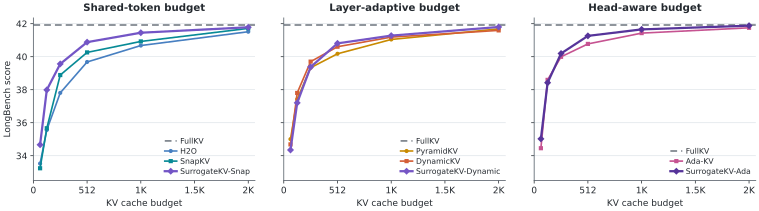

# Results and released data

[Back to SurrogateKV](../README.md)

## Results

### LongBench

LLaMA-3-8B-Instruct at `B_KV = 512` (FullKV: 41.92):

| Base allocation | Base | Base score | SurrogateKV variant | Score | Delta |
| --- | --- | ---: | --- | ---: | ---: |
| Shared token | SnapKV | 40.26 | SurrogateKV-Snap | **40.88** | +0.62 |
| Layer-wise | DynamicKV | 40.60 | SurrogateKV-Dynamic | **40.81** | +0.20 |
| Head-wise | Ada-KV | 40.77 | SurrogateKV-Ada | **41.26** | +0.49 |

<p align="center">
  <a href="../data/images/longbench_budget_sweep.pdf">
    <picture>
      <source media="(prefers-color-scheme: dark)" srcset="../data/images/longbench_budget_sweep-dark.svg">
      <source media="(prefers-color-scheme: light)" srcset="../data/images/longbench_budget_sweep.svg">
      
    </picture>
  </a>
</p>

The six-budget curves and per-dataset scores are in
[`data/longbench/llama3_8b_instruct/`](../data/longbench/llama3_8b_instruct/).
The x-axis uses the reported KV budgets on a linear scale.

### Needle-in-a-Haystack

Mistral-7B-Instruct-v0.2 at `B_KV = 128`:

| Base | Base score | SurrogateKV variant | Score |
| --- | ---: | --- | ---: |
| SnapKV | 87.51 | SurrogateKV-Snap | **98.84** |
| DynamicKV | 98.46 | SurrogateKV-Dynamic | **98.74** |
| Ada-KV | 90.04 | SurrogateKV-Ada | **98.18** |

<p align="center">
  <a href="../data/images/mistral_niah_k128_method_comparison.pdf">
    <picture>
      <source media="(prefers-color-scheme: dark)" srcset="../data/images/mistral_niah_k128_method_comparison-dark.svg">
      <source media="(prefers-color-scheme: light)" srcset="../data/images/mistral_niah_k128_method_comparison.svg">
      
    </picture>
  </a>
</p>

The heatmap grids for `B_KV = 64` and `128` are released under
[`data/niah/`](../data/niah/). The required head-wise evaluation path is recorded
in [`CORRECTIONS.md`](../CORRECTIONS.md).

## Released Data

[`data/README.md`](../data/README.md) indexes the CSV files for LongBench, NIAH,
motivation and attention diagnostics, ablations, merging comparisons, serving
efficiency, and model scaling. CSV is the canonical tabular format; duplicate
JSON exports are not needed to regenerate the released summaries. Run the data
checks and rebuild the README figures with:

```bash
python3 scripts/validate_release.py
python3 -m pip install -e ".[plots]"
python3 scripts/build_readme_figures.py
```
